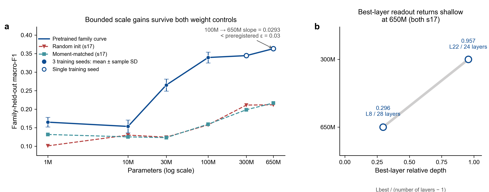

### 4.2 Is the gain real? Learned weights outperform architectural and weight-statistic controls

The bounded but non-monotone gain in the previous section raises the question of whether it reflects learned weight structure rather than architecture or initialization. The decisive experiments are S4, which replaces pretrained weights with random initialization while preserving the architecture and evaluation, and S5, which reinitializes each tensor while matching the mean and variance of the corresponding trained weights. A positive trained-model advantage survives both controls at every scale, excluding these two trivial explanations within the controlled evaluation.

| Parameters | Trained − random-init | Trained − moment-matched |
|---|---:|---:|
| 1M | +0.059 | +0.029 |
| 10M | +0.043 | +0.048 |
| 30M | +0.122 | +0.123 |
| 100M | +0.169 | +0.167 |
| 300M | +0.133 | +0.146 |
| 650M | +0.151 | +0.147 |

Entries are differences in best-layer family macro-F1, with each arm evaluated at its own best layer under the common probe protocol. They use the s17 trained run at each scale to match the control tables exactly; unlike the first four entries in the preceding scale table, these contrasts are not three-training-seed means. Figure 1 shows the corresponding trained and control curves.

The random-init contrasts show that the architecture and an untrained initialization cannot account for the trained scores. The moment-matched contrasts then exclude the narrower explanation that per-tensor weight means and variances alone carry the advantage: the two controls produce similar scores at every scale, whereas preserving only those statistics does not restore trained performance. Even at 10M, where the preceding scale curve dips at the seed-mean level, both controlled contrasts remain positive.

Together, these interventions support a causal attribution within the evaluated family: pretraining changes the configuration of the weights in ways that improve family-level readout, beyond architectural inductive bias and low-order weight statistics. The effect is substantial across the ladder but not monotone in scale, so the results do not reduce learned structure to a simple function of parameter count.

The reality of this learned-weight advantage, rather than its size, forces the next question: under family-held-out evaluation, how much does it add beyond simple sequence-composition baselines? These interventions cannot make that separation because neither control isolates the contribution of sequence-composition reading, and they cannot identify which learned features carry the gain.

