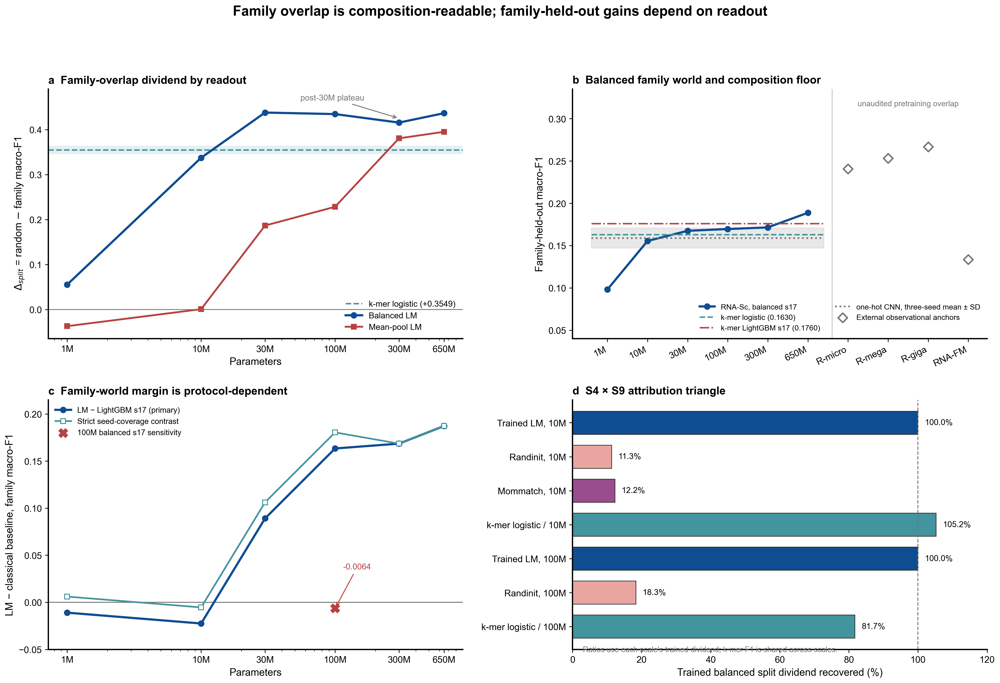

### 4.3 What is the learned signal worth under family-held-out generalization? A protocol-dependent margin above composition

This section asks how much the learned-weight advantage established in Section 4.2 is worth when evaluation requires generalization to held-out families. The decisive experiments are S9, crossing family and random splits with balanced and mean-pool readouts; a classical baseline group spanning k-mer logistic regression, k-mer LightGBM, a one-hot CNN, and a random-embedding head; and the S4-by-S9 attribution triangle across initialization controls, composition features, and splits. The random-split dividend under balanced probing rises from +0.055 to a post-30M plateau of +0.416 to +0.438, whereas the family-held-out margin over composition baselines is small at low scale and depends on the readout protocol.

The two-world results separate family overlap from scale itself. Under balanced probing, \(\Delta_{\mathrm{split}}=F1_{\mathrm{random}}-F1_{\mathrm{family}}\) reaches +0.4378 at 30M and remains between +0.4155 and +0.4364 thereafter. Mean-pool probing gives a different curve: its gap is near zero only at 1M and 10M (−0.0372 and +0.0006), then becomes positive from 30M onward (+0.1865 to +0.3950). Thus, the large balanced-probe dividend is not a universal property of every readout, and the older summary that mean pooling removes the gap does not describe the four larger scales. All entries in this split comparison are s17 observations within the same model and protocol; the random partition permits family overlap by construction, although neither probe partition was used for MLM pretraining.

| Parameters | Balanced family F1 | Balanced random F1 | Balanced \(\Delta_{\mathrm{split}}\) | Mean-pool \(\Delta_{\mathrm{split}}\) |
|---|---:|---:|---:|---:|
| 1M | 0.0982 | 0.1534 | +0.0552 | −0.0372 |
| 10M | 0.1555 | 0.4928 | +0.3373 | +0.0006 |
| 30M | 0.1675 | 0.6053 | +0.4378 | +0.1865 |
| 100M | 0.1696 | 0.6040 | +0.4344 | +0.2283 |
| 300M | 0.1715 | 0.5870 | +0.4155 | +0.3805 |
| 650M | 0.1888 | 0.6252 | +0.4364 | +0.3950 |

Classical models show that much of this dividend is available without pretraining. K-mer logistic regression alone obtains \(\Delta_{\mathrm{split}}=+0.3549\), while the directly supervised one-hot CNN averages +0.3754 across three seeds. In contrast, the random-embedding head has almost no split dividend (+0.0036). These comparisons identify sequence composition and family overlap as sufficient ingredients for a large random-split gain, rather than treating a high random-split score as evidence of family-held-out generalization.

| Baseline | Family F1 | Random F1 | \(\Delta_{\mathrm{split}}\) | Seed coverage |
|---|---:|---:|---:|---|
| k-mer (1–6) + logistic | 0.1630 | 0.5180 | +0.3549 | one fixed run, random_state=17 |
| k-mer (1–6) + LightGBM | 0.1760 | 0.5485 | +0.3725 | s17 only |
| one-hot CNN | 0.1589 ± 0.0119 | 0.5343 ± 0.0253 | +0.3754 | three-seed mean ± sample SD |
| random-embedding head | 0.0551 ± 0.0253 | 0.0587 ± 0.0103 | +0.0036 | three-seed mean ± sample SD |

The family-world comparison nevertheless changes substantially with readout. Under the P0.3 primary caliber, mean-pool LM minus the strongest observed classical baseline, LightGBM s17 at 0.1760, is negative at 1M and 10M but positive from 30M onward. LightGBM has no s29 or s43 result, so these are not complete three-seed-versus-three-seed contrasts. At the four three-seed LM scales, the separate strict seed-coverage comparison instead uses the three-seed one-hot CNN mean; it yields +0.0061, −0.0054, +0.1062, and +0.1804. Seed coverage is matched in this column, but the different model types are not claimed to be paired experiments.

| Parameters | Mean-pool LM family F1 | LM − LightGBM s17, \(\Delta_{\mathrm{obs}}\) | Strict seed-coverage contrast, \(\Delta_{\mathrm{strict}}\) |
|---|---:|---:|---:|
| 1M | 0.1650 ± 0.0131 | −0.0110 | +0.0061 vs CNN |
| 10M | 0.1535 ± 0.0173 | −0.0225 | −0.0054 vs CNN |
| 30M | 0.2651 ± 0.0162 | +0.0891 | +0.1062 vs CNN |
| 100M | 0.3394 ± 0.0147 | +0.1634 | +0.1804 vs CNN |
| 300M | 0.3445 (s17) | +0.1685 | +0.1685 vs LightGBM s17 |
| 650M | 0.3632 (s17) | +0.1872 | +0.1872 vs LightGBM s17 |

The balanced sensitivity analysis prevents this positive mean-pool slope from becoming an unconditional claim. At 100M, balanced-probe s17 scores 0.1696, exceeding k-mer logistic by only +0.0066 but falling below LightGBM s17 by −0.0064; mean-pool s17 instead scores 0.3263, or +0.1503 over the same LightGBM result. Consequently, the defensible family-held-out conclusion is protocol-specific: near-zero or negative margins occur at the two smallest mean-pool scales and in the 100M balanced comparison against LightGBM, while the primary mean-pool contrast turns positive at 30M and above. The 300M and 650M margins remain single-seed observations.

The attribution triangle then identifies what the balanced random dividend is made of. At 10M, random initialization captures 0.0380/0.3373 = 11.3% of the trained dividend and moment-matched reinitialization captures 0.0412/0.3373 = 12.2%; at 100M, random initialization captures 0.0795/0.4344 = 18.3%. K-mer logistic captures 105.2% of the 10M trained dividend and 81.7% at 100M. Learned weights therefore matter for reading the family-overlap signal—untrained or moment-matched weights recover little of it—but composition features are sufficient for a classical model to reproduce most of that signal. Within these controlled cells, the random-split scale dividend is mainly a protocol-enabled, composition-level family-overlap phenomenon, not a measure of transferable knowledge acquired through scale.

**Strongest alternative explanation (B3).** The initialization controls and composition baselines do not establish that the remaining family-world LM signal is distinct from composition reading: both may exploit the same underlying sequence statistics. The controlled triangle supports attribution of the random-split dividend, but it cannot decompose the learned family-world representation into composition and non-composition components.

**Figure 2 | What is pretrained transfer worth under family-held-out generalization?** (a) Random-minus-family macro-F1 under balanced and mean-pool readouts, with the k-mer logistic dividend as a reference band. (b) Balanced family-world scores for the controlled s17 ladder and classical baselines; external RiNALMo micro/mega/giga (0.2407/0.2532/0.2667) and RNA-FM (0.1335) points are observational anchors only because their pretraining exposure to the evaluation families cannot be audited. (c) Mean-pool LM margins over LightGBM s17, strict seed-coverage contrasts, and the 100M balanced sensitivity point; the LightGBM baseline is single-seed and no uncertainty is imputed. (d) Percentage of the trained balanced random-split dividend recovered by initialization controls and k-mer logistic. Together, the panels distinguish a composition-reproducible protocol dividend from the smaller, readout-dependent family-world margin.

The location of this protocol-dependent transferable signal now forces the next question: where in the network does it reside, and why does readable family signal erode at 10M and return to shallower layers at 650M? This section cannot localize that signal, explain its training dynamics, separate learned family-world structure from composition reading (B3), or establish training-seed robustness at 300M and 650M.
