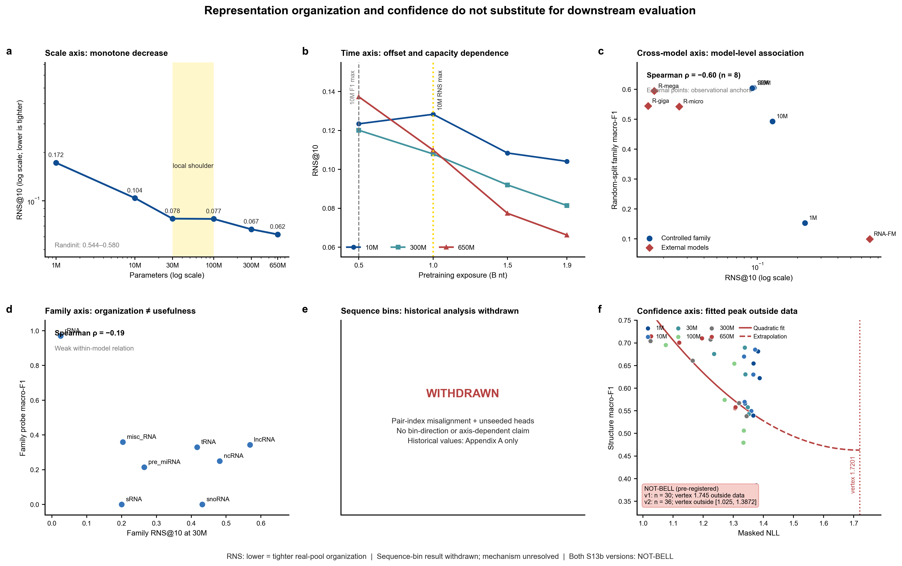

### 4.7 Cross-cutting diagnostics: representation organization and confidence do not identify downstream utility

This cross-cutting section asks whether representation geometry or likelihood confidence can stand in for downstream usefulness, thereby testing the protein-derived diagnostics that motivate H7 and H8 rather than adding another rung to the Q1–Q6 chain. The decisive experiments are S14, which measures random-neighbor share (RNS) across scale, training time, models, families, and sequence bins, and S13b, which applies a pre-registered bell-curve decision rule to family-level masked negative log-likelihood (NLL) and structure F1. The joint phenomenon is a dissociation: RNS becomes tighter without tracking transfer across every axis, while the confidence–structure relation remains NOT-BELL because the sampled RNA models never reach the fitted high-NLL regime.

#### RNS improves with scale but does not track family transfer

RNS@10 measures the share of random sequences among a real sequence's nearest neighbors; lower values therefore indicate tighter organization of the real pool. Across the controlled endpoints, it decreases monotonically from 0.1721 at 1M to 0.1041, 0.0776, 0.0773, 0.0667, and 0.0620 at 10M, 30M, 100M, 300M, and 650M, respectively. The near-equality at 30M and 100M creates a local shoulder even though family macro-F1 rises sharply between those scales, and the subsequent RNS decreases show that this shoulder is not a global representation ceiling. Random-initialization controls remain much less organized (RNS@10 = 0.5442–0.5803), while ten random-pool regenerations give standard deviations of only 0.0037–0.0049 at the three tested scales; these are descriptive geometry checks, not training-seed uncertainty estimates.

The training-time axis further separates organization from utility. At 10M, RNS@10 reaches its maximum (worst organization) at 1.0B nt (0.1283), one checkpoint after the family-F1 maximum at 0.5B nt (0.2549), before declining to 0.1041 at 1.9B nt. In contrast, the 300M and 650M trajectories decline monotonically over the four sampled checkpoints, from 0.1201 to 0.0814 and from 0.1373 to 0.0662, respectively. This capacity-dependent difference is consistent with the supply-and-capacity account developed in Q4 and Q6, but the time courses are single-run descriptive measurements and do not identify a causal mechanism by themselves.

Cross-model behavior supports only a model-level association. Across eight models, Spearman's correlation between RNS@10 and random-split family F1 is −0.5952 (rounded to −0.60), with lower RNS accompanying higher F1; excluding the RNA-FM outlier weakens the estimate to −0.3929. Because four points come from the controlled family and four from external models with unauditable pretraining exposure, this is an observational anchor rather than a controlled cross-architecture result. Within the 30M model, the family-level correlation is only −0.1916 across eight families, too weak to treat geometric separation as a general ranking of downstream family performance.

The former sequence-level RNS-binning direction is withdrawn. The historical high-versus-low increases are retained only as superseded calculations in Appendix A because the pair labels used one-based indices incorrectly and the probe heads were not seeded. Consequently, neither a reversal relative to proteins nor the previously proposed axis-dependent length-confound mechanism is adjudicated. The retained RNS evidence is restricted to the scale, training-time, cross-model, and family axes above and the direct RNS–COV association below; none of these results establishes a per-sequence uncertainty proxy with a transferable sign.

**Direct RNS–COV association is weak to moderate.** In the 30M model, per-sequence Spearman \(\rho=-0.2966\) with bootstrap 95% CI \([-0.4732,-0.1128]\) (\(n=108\)) indicates that lower RNS accompanies stronger COV − CTRL, but the strength does not support RNS as a strong structural-reliability proxy. The historical `s14_rns_cov.json` contains masked-marginal NLL rather than COV and is not evidence for this association; the new test uses actual mutation COV and remains within its own sequence protocol.

#### The pre-registered confidence bell is absent within the sampled NLL domain

S13b tests whether structure F1 first rises and then falls as masked NLL increases, the confidence-mediated pattern motivating the protein comparison \citep{hou_scaling}. The v1 fit contains 30 trained-model family points and places its quadratic vertex at NLL = 1.745, outside the observed range of approximately 1.34–1.38; it therefore returns the pre-registered NOT-BELL decision. Adding the 650M points in v2 gives 36 trained-model family points, widens the trained-point NLL range to 1.025–1.3872, and still places the vertex outside the data at 1.7201, again NOT-BELL under the same rule. The additional points broaden confidence coverage but are not independent training-seed replications, so they strengthen the domain-coverage check without upgrading the underlying descriptive evidence.

The negative result has a specific mechanistic interpretation: within this corpus and budget, the models do not sample the high-NLL, over-confident regime required for a descending right-hand limb, so the precondition for transferring Hou et al.'s protein account is unmet. It does not imply that RNA representations lack pairing knowledge, nor does it prove that no bell could appear under a different corpus, budget, task, or confidence measure; this boundary is consistent with the direct forward and paired-readout evidence in Q5. Likewise, family-level RNS is nearly unrelated to masked-marginal NLL (Spearman \(\rho=0.1429\), Pearson \(r=-0.0186\)), reinforcing that geometry, likelihood confidence, and downstream utility are distinct measurement axes.

**Figure 6 | Can representation geometry or likelihood confidence substitute for downstream evaluation?** Panels show the RNS scale axis, training-time axis, cross-model and family associations, the withdrawn sequence-binning analysis, and the S13b confidence–structure fit. Lower RNS denotes tighter real-sequence organization; the 30M–100M shoulder is channel-specific. The binning panel retains no effect values or directional claim because pair-index misalignment and unseeded heads invalidate the historical analysis, leaving the axis-dependent mechanism unresolved. Both v1 and v2 retain the pre-registered NOT-BELL outcome because their fitted vertices lie outside the observed NLL ranges.

These diagnostics lead directly to the integrated discussion: supply, representation organization, confidence, and readout must be treated as interacting but non-interchangeable components of transfer. They cannot establish a universal RNS–utility relationship, a sequence-level uncertainty estimator, a causal capacity mechanism, or the absence of confidence-mediated behavior outside the evaluated RNA domain.
